# devsetup-e11
E1-1 Dev Environment Setup


# E1-1 내 컴퓨터에 개발자용 작업실 꾸미기

## 프로젝트 개요
터미널, Docker, Git이라는 개발자 필수 도구 3종을 직접 세팅하며, 현대적 개발 워크플로우의 기반을 다집니다. 단순한 명령어 복사-붙여넣기가 아닌, 실행 결과(로그/데이터)를 통해 시스템의 동작 원리를 검증하는 데 집중합니다.

## 프로젝트 학습 목표
- Linux CLI 숙달: 주요 명령어 CMD, 절대/상대 경로 구분, 파일 권한(755, 644) 체계 이해
- Docker 컨테이너화: Dockerfile을 활용한 커스텀 이미지 빌드 및 실행 환경 격리
- Docker 네트워크 및 저장소: 포트 매핑의 필요성 인지 및 Docker 볼륨을 통한 데이터 영속성 확보
- 버전 관리: Git(로컬)과 GitHub(원격)의 역할 차이 명확화


## 수행 체크리스트
- [ ] a. 실행환경
- [ ] b. 터미널 기본 조작 및 폴더 구성
- [ ] c. 권한 변경 실습
- [ ] d. Docker 설치/점검
- [ ] e. hello-world 실행
- [ ] f. Dockerfile 빌드/실행
- [ ] g. 포트 매핑 접속(2회)
- [ ] h. 바인드 마운트 반영
- [ ] i. 볼륨 영속성
- [ ] j. Git 설정 + VSCode GitHub 연동

<br>

## a. 실행환경
- OS: Ubuntu 26.04.1 LTS
- Shell: Bash
- Docker: version 29.9.3
- Git: version 2.53.0

<br/>

```bash

# Ubuntu 버전 && Shell 종류 && Docker 버전 && Git 버전 확인 CMD
$ lsb_release -d && echo $SHELL && docker --version && git --version

# 실행환경 출력값
Description:    Ubuntu 26.04.1 LTS
/bin/bash
Docker version 29.9.3, build 5457199
git version 2.53.0
```

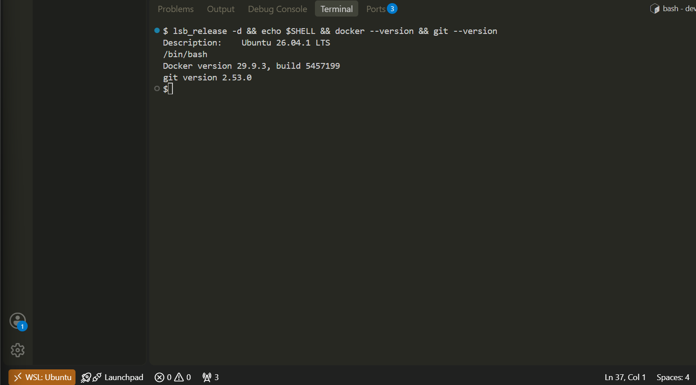


## b. 터미널 기본 조작 및 폴더 구성

```bash
$PS1="$"            # ID익명화
$cd ~               # user Home dir로 이동 (/home/username)
$cd ..              # User Home 상위 dir인 Home 폴더로 이동 
$pwd                # working dir 확인 cmd
/home               # working dir 출력 (/home) 
$cd ~               # user home dir 이동
$mkdir test-hello   # test-hello dir 생성
$cd ~/test-hello    # test-hello dir 이동
$mkdir "test0" "test1"  # "test0" "test1" 2개 dir 생성
$cd test0               # /test-hello/test0 dir 이동
$touch empty.txt        # empty.txt 파일 생성

$ls -alh    # test0 dir 내 모든 dir/파일 list cmd  
total 8.0K  # 모든 파일 및 숨김 Dir 출력  
drwxr-xr-x 2 owner group 4.0K Nov 12 19:22 .
drwxr-xr-x 4 owner group 4.0K Nov 12 19:20 ..
-rw-r--r-- 1 owner group    0 Nov 12 19:22 empty.txt
# "empty.txt" 빈 파일로 생성 확인

$rm empty.txt       # "empty.txt" 삭제 cmd
$ls -alh            # test0 dir 아래 모든 dir/파일 나열 cmd
total 8.0K
drwxr-xr-x 2 owner group 4.0K Nov 12 19:23 .
drwxr-xr-x 4 owner group 4.0K Nov 12 19:20 ..
# "empty.txt" 파일 내역 삭제 확인

$cd ../test1        # /test-hello/test1 dir로 이동 cmd
$touch hello.txt    # "hello.txt" 파일 생성 cmd
$echo "hello world" >> hello.txt    
# "hello.txt" 파일에 "hello world" 문장 text 삽입 cmd 
$cat hello.txt          # "hello.txt" 파일 내용 출력 cmd 
hello world             # "hello world" 출력  
$cat -n hello.txt       # -n 파일 내용 줄번호 포함 출력 cmd
     1  hello world     # 줄번호 1 포함 "hello world" 출력
$
```

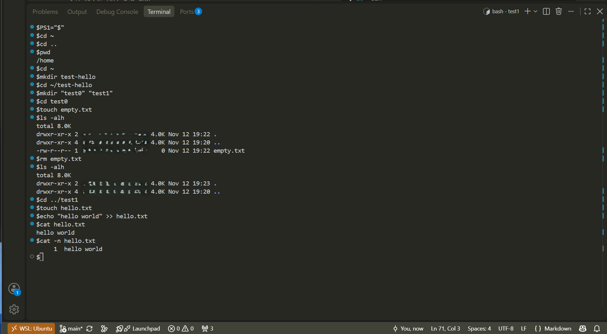

<br>

```bash

$ls                 # 하위 dir 목록 cmd
test0  test1
$cp -r test1 test2  # test1 dir 을 test2 dir 로 복사 
# -r 하위 목록 포함 옵션 
$ls                 # 하위 dir 목록 list cmd
test0  test1  test2 # test2 dir 복사 확인
$cd test2           # test2 dir 이동
$ls                 # test2 dir 목록 list cmd
hello.txt           # test2 dir 내 목록 파일 확인

$mv hello.txt hello-world.txt
# hello.txt 파일명을 hello-world.txt 로 변경 cmd
$ls                 # test2 dir 목록 list cmd
hello-world.txt     # test2 dir 내 파일명 변경 확인
$
```

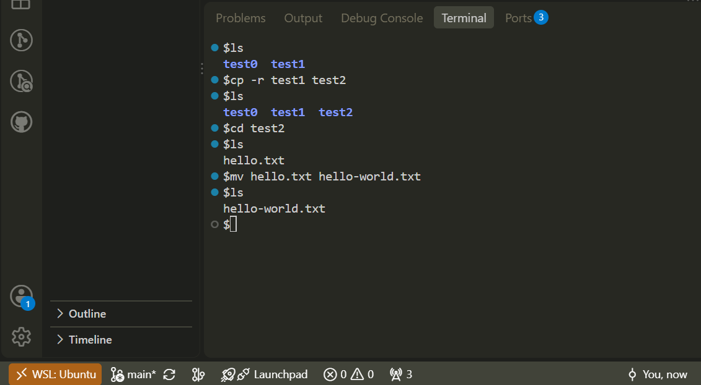


## c. 권한 변경 실습
### 리눅스(Linux)에서 755와 644는 파일과 디렉터리의 접근 권한을 숫자로 나타낸 값입니다.

권한 숫자는 [소유자(User)] - [그룹(Group)] - [기타 사용자(Others)] 순서로 구성되며, 읽기(4), 쓰기(2), 실행(1) 권한의 합계로 계산합니다.

숫자별 권한 계산법 (참고)

- 4 = 읽기 (Read, r)
- 2 = 쓰기 (Write, w)
- 1 = 실행 (Execute, x)
- 0 = 권한 없음 (-)

#### 755 권한 기호 표기: rwxr-xr-x
#### 644 권한 기호 표기: rw-r--r--


```bash
$ls -lh             # list segment cmd
total 12K
drwxr-xr-x 2 User Group 4.0K Nov 12 19:23 test0   
drwxr-xr-x 2 User Group 4.0K Nov 12 21:32 test1
drwxr-xr-x 2 User Group 4.0K Nov 12 21:38 test2   
# test2 dir 현재 권한 755 drwxr-xr-x
$chmod 754 test2    # 754로 권한 변경 (기타사용자 실행 권한 'x' 제거)
$ls -lh             # list segment cmd 재실행
total 12K
drwxr-xr-x 2 User Group 4.0K Nov 12 19:23 test0
drwxr-xr-x 2 User Group 4.0K Nov 12 21:32 test1
drwxr-xr-- 2 User Group 4.0K Nov 12 21:38 test2   
# test2 dir 754로 권한 변경 확인 drwxr-xr--  
$cd test2 && ls -lh
total 4.0K
-rw-r--r-- 1 User Group 12 Nov 12 21:37 hello-world.txt  
# "hello-world.txt" 파일 권한 644 확인 -rw-r--r--  
$chmod 755 hello-world.txt && ls -lh 
# 파일권한 755로 변경 후 list segment cmd 
total 4.0K
-rwxr-xr-x 1 User Group 12 Nov 12 21:37 hello-world.txt
# "hello-world.txt" 파일 권한 755 변경 확인 -rwxr-xr-x  
$
```
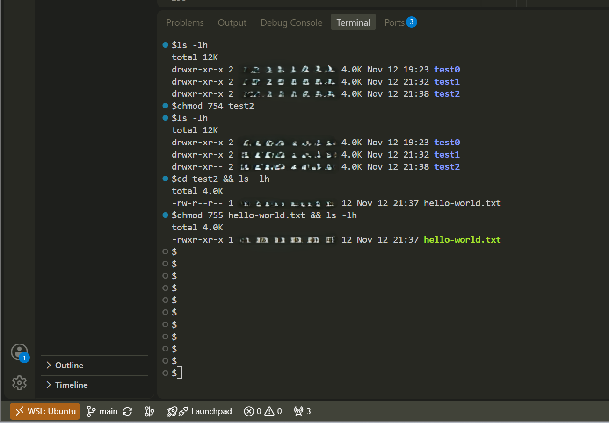


## d. Docker 설치 / hello-world

- Docker 버전 확인
- hello-world 실행 확인 
- Docker daemon 정상 동작 확인

```bash
$ docker --version
docker run hello-world
Docker version 29.9.3, build 5457199  # docker 버전 확인

# docker daemon 정상 동작 확인
Hello from Docker!
This message shows that your installation appears to be working correctly.

To generate this message, Docker took the following steps:
 1. The Docker client contacted the Docker daemon.
 2. The Docker daemon pulled the "hello-world" image from the Docker Hub.
    (amd64)
 3. The Docker daemon created a new container from that image which runs the
    executable that produces the output you are currently reading.
 4. The Docker daemon streamed that output to the Docker client, which sent it
    to your terminal.

To try something more ambitious, you can run an Ubuntu container with:
 $ docker run -it ubuntu bash
```
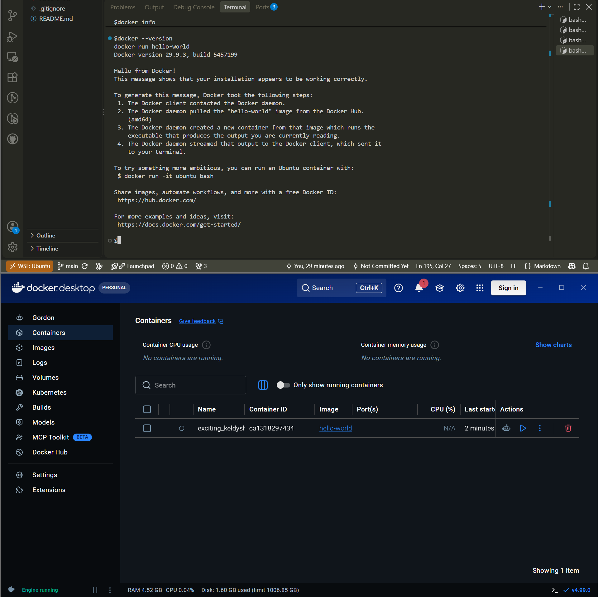


## e. Docker 기본 운영 명령 수행

- docker 기본 명령 수행 
- images / ps / logs / stats
 

```bash
$ docker images      
                                                                                                     i Info →   U  In Use
IMAGE                ID             DISK USAGE   CONTENT SIZE   EXTRA
hello-world:latest   e2ac70e7319a       10.1kB             0B    U   
$
$ docker ps -a
CONTAINER ID   IMAGE         COMMAND    CREATED          STATUS                      PORTS     NAMES
d1e28051c114   hello-world   "/hello"   39 minutes ago   Exited (0) 23 minutes ago             unruffled_proskuriakova
$
$ docker logs -ft --tail 10 d1e28051c114     # 마지막 10줄 실행 결과(--tail) 계속 추적하면서(-f) 시간과 함께 출력(-t)
2026-11-15T11:05:56.657074974Z 
2026-11-15T11:05:56.657075580Z To try something more ambitious, you can run an Ubuntu container with:
2026-11-15T11:05:56.657076185Z  $ docker run -it ubuntu bash
2026-11-15T11:05:56.657076875Z 
2026-11-15T11:05:56.657077475Z Share images, automate workflows, and more with a free Docker ID:
2026-11-15T11:05:56.657082024Z  https://hub.docker.com/
2026-11-15T11:05:56.657082631Z 
2026-11-15T11:05:56.657083049Z For more examples and ideas, visit:
2026-11-15T11:05:56.657083572Z  https://docs.docker.com/get-started/
2026-11-15T11:05:56.657084012Z 
$
$ docker run -d --name monitor-test nginx       # monitor-test 웹서버 container 생성
Unable to find image 'nginx:latest' locally
latest: Pulling from library/nginx
37fb86c2a767: Pull complete 
512ac5e7ce8e: Pull complete 
1724c05f72c6: Pull complete 
bbb080c71d50: Pull complete 
1962e1ff75b4: Pull complete 
7cb4701ce7cd: Pull complete 
6d2e43921e9e: Pull complete 
Digest: sha256:165ddde8751e75a1c907d24ef10d9f6deb08b57e0fe56caf67512486aff76d82
Status: Downloaded newer image for nginx:latest
f429c08f48fca75a30f862e27c3426b36a7e9ac32964655cf22725eb457ab677
$
$ docker stats --no-stream    # 현재 stats snapshot 으로 출력 (--no-stream)  
CONTAINER ID   NAME           CPU %     MEM USAGE / LIMIT    MEM %     NET I/O         BLOCK I/O     PIDS
f429c08f48fc   monitor-test   0.00%     19.3MiB / 23.47GiB   0.08%     1.17kB / 126B   0B / 12.3kB   25
$

```

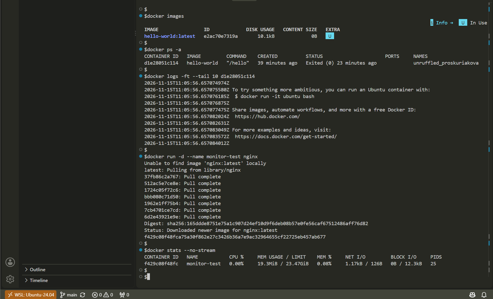

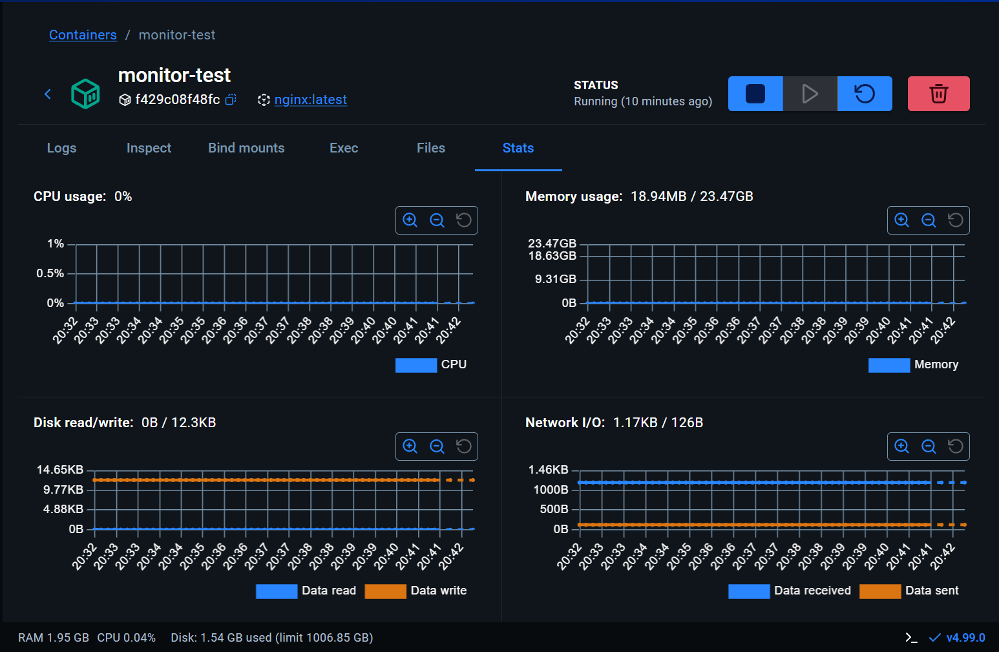


## f. 컨테이너 실행 실습 

- hello-world 실행 (d에 기록)

- ubuntu 컨테이너 실행 후 ls, echo 명령 수행

```bash

$ docker run -it --name my-ubuntu ubuntu bash   # ubuntu container 생성 # -it: 터미널 입력  # bash: 컨테이너 내부 bash 쉘 실행
Unable to find image 'ubuntu:latest' locally
latest: Pulling from library/ubuntu
517b871c26ea: Pull complete 
96aae9022e0e: Pull complete 
Digest: sha256:065aa8626841f16057b78b027b464cd59c4fac36c204c72dcbf48d66f5fa8a96
Status: Downloaded newer image for ubuntu:latest

root@f0641763d354:/# ls  # ubuntu container 내 root 폴더에서  list segment 
bin  boot  dev  etc  home  lib  lib64  media  mnt  opt  proc  root  run  sbin  srv  sys  tmp  usr  var

root@f0641763d354:/# 
root@f0641763d354:/# echo "Hello world from Ubuntu" # Ubuntu container 에서 "" 출력 
Hello world from Ubuntu

root@f0641763d354:/# exit  # Ubuntu container 종료 
exit
$

$ docker logs my-ubuntu    # my-ubuntu container 의 실행 로그 확인
root@f0641763d354:/# ls
bin  boot  dev  etc  home  lib  lib64  media  mnt  opt  proc  root  run  sbin  srv  sys  tmp  usr  var
root@f0641763d354:/# 
root@f0641763d354:/# echo "Hello world from Ubuntu"
Hello world from Ubuntu
root@f0641763d354:/# exit
exit
$

```

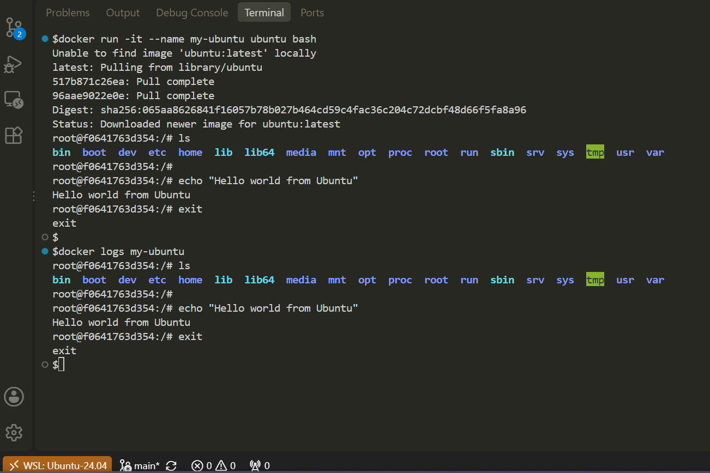


<br/>

- exec vs attach 차이 확인


```bash

$
$docker run -dit --name test-exec ubuntu /bin/bash    # exec 확인용 container 'test-exec' 생성 
0d96300f4ed836c515158afecd17a176204c71f911d7fcf0228e75a68ecb84f1
$
$docker exec -it test-exec bash     # exec cmd 를 통해 'test-exec' 내부에서 새로운 bash 실행     
root@0d96300f4ed8:/#       # test-exec 내부
root@0d96300f4ed8:/# ls
bin  boot  dev  etc  home  lib  lib64  media  mnt  opt  proc  root  run  sbin  srv  sys  tmp  usr  var
root@0d96300f4ed8:/# 
root@0d96300f4ed8:/# exit     # exec cmd bash 에서 exit
exit
$
$docker ps -a     # exit 이후에도 test-exec 의 /bin/bash 명령은 그대로 유지 [STATUS Up 36 seconds]  
CONTAINER ID   IMAGE     COMMAND       CREATED          STATUS          PORTS     NAMES
0d96300f4ed8   ubuntu    "/bin/bash"   36 seconds ago   Up 36 seconds             test-exec
$
$
$docker run -dit --name test-attach ubuntu /bin/bash  # attach 확인용 container 'test-exec' 생성
9451f3101a0246dfbb60ff328965930cad45b426018ba9b607ac1fc9c2abeed1
$
$docker ps     # test-exec test-attach 컨테이너 둘 모두 running 상태 [STATUS UP]
CONTAINER ID   IMAGE     COMMAND       CREATED              STATUS              PORTS     NAMES
9451f3101a02   ubuntu    "/bin/bash"   25 seconds ago       Up 24 seconds                 test-attach
0d96300f4ed8   ubuntu    "/bin/bash"   About a minute ago   Up About a minute             test-exec
$
$docker attach test-attach    # attach cmd 로 test-attach container bash 에 곧바로 연결 
root@9451f3101a02:/# 
root@9451f3101a02:/# exit     # attach cmd bash 에서 exit
exit
$
$docker ps -a     #  test-attach 컨테이너는 작동 중지 확인 [STATUS Exited (0) 12 seconds ago]
CONTAINER ID   IMAGE     COMMAND       CREATED              STATUS                      PORTS     NAMES
9451f3101a02   ubuntu    "/bin/bash"   About a minute ago   Exited (0) 12 seconds ago             test-attach
0d96300f4ed8   ubuntu    "/bin/bash"   2 minutes ago        Up 2 minutes                          test-exec
$


```

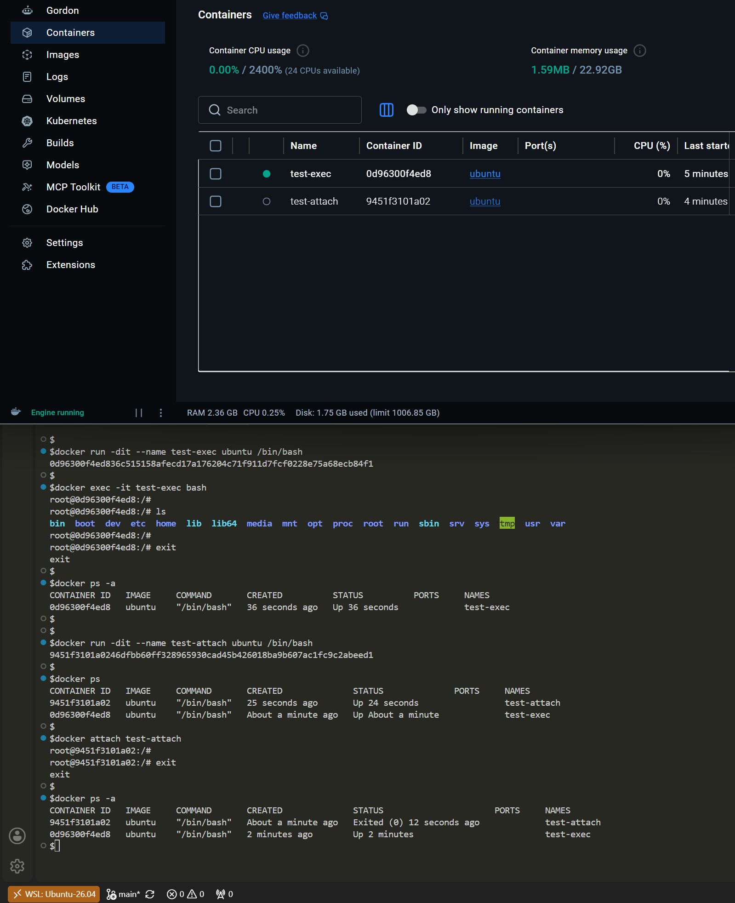


## g. Dockerfile 빌드/실행

- 아래 내용으로 "Dockerfile", "index.html" 두개의 파일 생성 후 
- cdsy-nginx 폴더에 저장

```bash

$basename "$PWD" && ls
cdsy-nginx              # Dockerfile source 폴더
Dockerfile  index.html  # cdsy-nginx 폴더에 2개 파일 저장 확인

$cat Dockerfile      # Dockerfile 내용 출력

# 1. 베이스 이미지 선택
FROM nginx:latest       

# 2. Label 정보
LABEL org.opencontainers.image.description="CDSY All in One"
LABEL org.opencontainers.image.version="1.0.0"

# 3. 기본 index.html을 내가 만든 파일로 교체
# NGINX의 기본 웹 루트 경로는 /usr/share/nginx/html
COPY index.html /usr/share/nginx/html/index.html

# 4. 포트 설정
EXPOSE 80

$cat index.html   # index.html 내용 출력
<br/>
<br/>
<h1 style="font-size: 48px; text-align: center;">My Codyssey NGINX Server</h1>
<p  style="font-size: 36px; text-align: center;">Hello CDSY World</p>

```

- Docker Image 및 Container 생성
- Image Name:        cdsy-nginx:v1.0
- Container Name:    cdsy-server

```bash
$
$basename "$PWD"
cdsy-nginx
$
$docker build -t cdsy-nginx:v1.0 .  # Docker 커스텀 Image Build
[+] Building 2.0s (7/7) FINISHED                                                                                 docker:default
 => [internal] load build definition from Dockerfile                                                                       0.0s
 => => transferring dockerfile: 431B                                                                                       0.0s
 => [internal] load metadata for docker.io/library/nginx:latest                                                            1.1s
 => [internal] load .dockerignore                                                                                          0.0s
 => => transferring context: 2B                                                                                            0.0s
 => [1/2] FROM docker.io/library/nginx:latest@sha256:165ddde8751e75a1c907d24ef10d9f6deb08b57e0fe56caf67512486aff76d82      0.0s
 => => resolve docker.io/library/nginx:latest@sha256:165ddde8751e75a1c907d24ef10d9f6deb08b57e0fe56caf67512486aff76d82      0.0s
 => [internal] load build context                                                                                          0.0s
 => => transferring context: 32B                                                                                           0.0s
 => CACHED [2/2] COPY index.html /usr/share/nginx/html/index.html                                                          0.0s
 => exporting to image                                                                                                     0.8s
 => => exporting layers                                                                                                    0.0s
 => => exporting manifest sha256:eba96d76942c94d1b787d065c8c7f13dc6922213d05b8c31d016e573caf9cca7                          0.0s
 => => exporting config sha256:47ba1a6b1a997e0487c0ef045ebee487ae3454ff8a560ecbdecde2c771ac41c3                            0.0s
 => => exporting attestation manifest sha256:36b1f682a134f6500e0796622d4486deca3c4f08d0d5d6e113a2192d633e7c4c              0.0s
 => => exporting manifest list sha256:0d67fbd349ff4a5ceb6dfcbb316924cf1516df7ee28528844c0effb9a5f4bc3d                     0.0s
 => => naming to docker.io/library/cdsy-nginx:v1.0                                                                         0.0s
 => => unpacking to docker.io/library/cdsy-nginx:v1.0                                                                      0.7s
$
# Docker Custom Container 생성 
$docker run -d -p 8080:80 --name cdsy-server cdsy-nginx:v1.0   
c6f560257db785a2d3f469b45ed76aaa580aa4b64b4d3096ec3b2d99332d8785
$
$docker ps     
# Docker Custom Container 동작 확인 [STATUS UP 10 minutes]
# Port Mapping 확인 [PORTS  0.0.0.0:8080->80/tcp, [::]:8080->80/tcp]
CONTAINER ID   IMAGE             COMMAND                  CREATED          STATUS          PORTS                                     NAMES
c6f560257db7   cdsy-nginx:v1.0   "/docker-entrypoint.…"   10 minutes ago   Up 10 minutes   0.0.0.0:8080->80/tcp, [::]:8080->80/tcp   cdsy-server
```

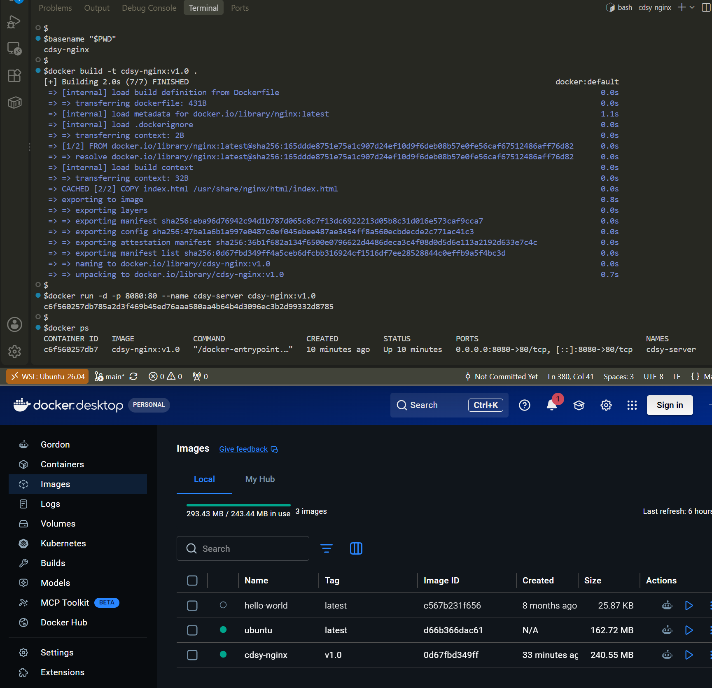


## h. 포트 매핑 접속 증거

```bash
$docker ps
CONTAINER ID   IMAGE             COMMAND                  CREATED          STATUS          PORTS                                     NAMES
c6f560257db7   cdsy-nginx:v1.0   "/docker-entrypoint.…"   23 minutes ago   Up 23 minutes   0.0.0.0:8080->80/tcp, [::]:8080->80/tcp   cdsy-server
$
$curl localhost:8080    # localhost 8080 을 통한 cdsy-server 출력값 확인 
<br/>
<br/>
<h1 style="font-size: 48px; text-align: center;">My Codyssey NGINX Server</h1>
<p  style="font-size: 36px; text-align: center;">Hello CDSY World</p>
$
```

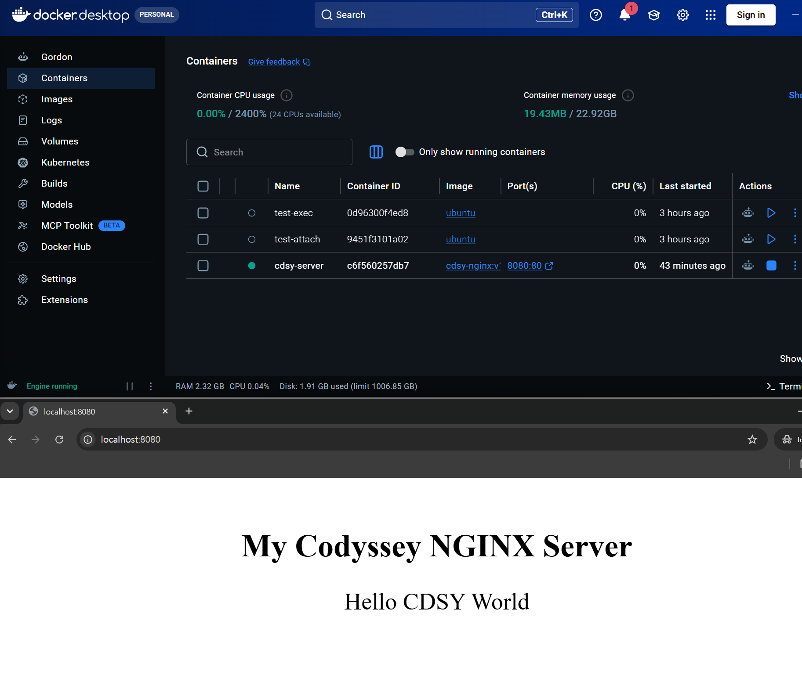


## i. 바인드 마운트 반영

```bash

```


## j. 볼륨 영속성

```bash

```


## k. Git 설정 + VSCode GitHub 연동

```bash

```


