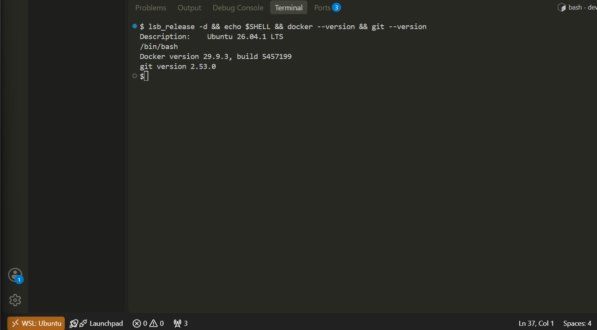
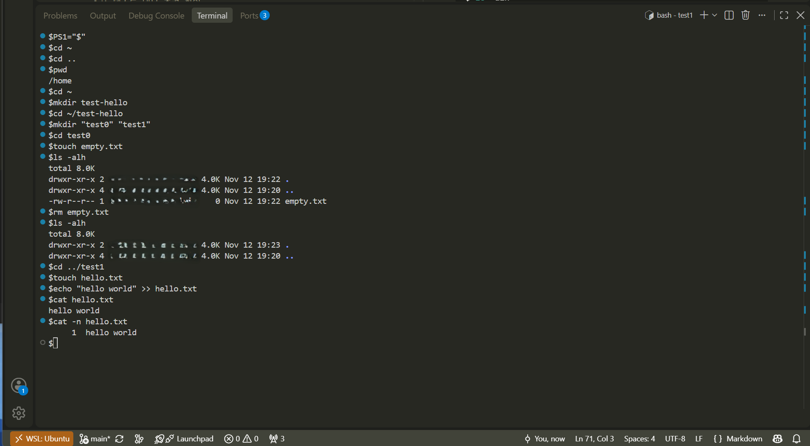
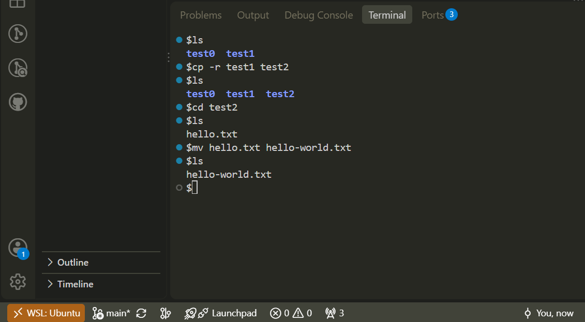

# devsetup-e11
E1-1 Dev Environment Setup


# E1-1 내 컴퓨터에 개발자용 작업실 꾸미기

## 프로젝트 개요
터미널, Docker, Git이라는 개발자 필수 도구 3종을 직접 세팅하며, 현대적 개발 워크플로우의 기반을 다집니다. 단순한 명령어 복사-붙여넣기가 아닌, 실행 결과(로그/데이터)를 통해 시스템의 동작 원리를 검증하는 데 집중합니다.

## 프로젝트 학습 목표
- Linux CLI 숙달: 주요 명령어 CMD, 절대/상대 경로 구분, 파일 권한(755, 644) 체계 이해
- Docker 컨테이너화: Dockerfile을 활용한 커스텀 이미지 빌드 및 실행 환경 격리
- Docker 네트워크 및 저장소: 포트 매핑의 필요성 인지 및 Docker 볼륨을 통한 데이터 영속성 확보
- 버전 관리: Git(로컬)과 GitHub(원격)의 역할 차이 명확화


## 수행 체크리스트
- [ ] a. 실행환경
- [ ] b. 터미널 기본 조작 및 폴더 구성
- [ ] c. 권한 변경 실습
- [ ] d. Docker 설치/점검
- [ ] e. hello-world 실행
- [ ] f. Dockerfile 빌드/실행
- [ ] g. 포트 매핑 접속(2회)
- [ ] h. 바인드 마운트 반영
- [ ] i. 볼륨 영속성
- [ ] j. Git 설정 + VSCode GitHub 연동

<br>

## a. 실행환경
- OS: Ubuntu 26.04.1 LTS
- Shell: Bash
- Docker: version 29.9.3
- Git: version 2.53.0

<br/>

```bash

# Ubuntu 버전 && Shell 종류 && Docker 버전 && Git 버전 확인 CMD
$ lsb_release -d && echo $SHELL && docker --version && git --version

# 실행환경 출력값
Description:    Ubuntu 26.04.1 LTS
/bin/bash
Docker version 29.9.3, build 5457199
git version 2.53.0
```




## b. 터미널 기본 조작 및 폴더 구성

```bash
$PS1="$"            # ID익명화
$cd ~               # user Home dir로 이동 (/home/username)
$cd ..              # User Home 상위 dir인 Home 폴더로 이동 
$pwd                # working dir 확인 cmd
/home               # working dir 출력 (/home) 
$cd ~               # user home dir 이동
$mkdir test-hello   # test-hello dir 생성
$cd ~/test-hello    # test-hello dir 이동
$mkdir "test0" "test1"  # "test0" "test1" 2개 dir 생성
$cd test0               # /test-hello/test0 dir 이동
$touch empty.txt        # empty.txt 파일 생성

$ls -alh    # test0 dir 내 모든 dir/파일 list cmd  
total 8.0K  # 모든 파일 및 숨김 Dir 출력  
drwxr-xr-x 2 owner group 4.0K Nov 12 19:22 .
drwxr-xr-x 4 owner group 4.0K Nov 12 19:20 ..
-rw-r--r-- 1 owner group    0 Nov 12 19:22 empty.txt
# "empty.txt" 빈 파일로 생성 확인

$rm empty.txt       # "empty.txt" 삭제 cmd
$ls -alh            # test0 dir 아래 모든 dir/파일 나열 cmd
total 8.0K
drwxr-xr-x 2 owner group 4.0K Nov 12 19:23 .
drwxr-xr-x 4 owner group 4.0K Nov 12 19:20 ..
# "empty.txt" 파일 내역 삭제 확인

$cd ../test1        # /test-hello/test1 dir로 이동 cmd
$touch hello.txt    # "hello.txt" 파일 생성 cmd
$echo "hello world" >> hello.txt    
# "hello.txt" 파일에 "hello world" 문장 text 삽입 cmd 
$cat hello.txt          # "hello.txt" 파일 내용 출력 cmd 
hello world             # "hello world" 출력  
$cat -n hello.txt       # -n 파일 내용 줄번호 포함 출력 cmd
     1  hello world     # 줄번호 1 포함 "hello world" 출력
$
```



<br>

```bash

$ls                 # 하위 dir 목록 cmd
test0  test1
$cp -r test1 test2  # test1 dir 을 test2 dir 로 복사 
# -r 하위 목록 포함 옵션 
$ls                 # 하위 dir 목록 list cmd
test0  test1  test2 # test2 dir 복사 확인
$cd test2           # test2 dir 이동
$ls                 # test2 dir 목록 list cmd
hello.txt           # test2 dir 내 목록 파일 확인

$mv hello.txt hello-world.txt
# hello.txt 파일명을 hello-world.txt 로 변경 cmd
$ls                 # test2 dir 목록 list cmd
hello-world.txt     # test2 dir 내 파일명 변경 확인
$
```




## c. 권한 변경 실습

```
#

```


## d. Docker 설치/점검

```

```


## e. hello-world 실행

```

```


## f. Dockerfile 빌드/실행

```
```


## g. 포트 매핑 접속(2회)

```
```


## h. 바인드 마운트 반영

```
```


## i. 볼륨 영속성

```
```


## j. Git 설정 + VSCode GitHub 연동

```
```


